# 基于springboot的乡村政务办公系统的设计与实现

> 🎓 **计算机毕业设计 · 基于springboot的乡村政务办公系统的设计与实现**
>
> 本仓库只放**项目介绍 + 运行截图**（截图是站点带水印的原图，存在仓库 `images/` 里）。
>
> 👉 **完整可运行源码 / 数据库脚本 / 部署文档：[点我获取](https://geekcode.top/archives/%E5%9F%BA%E4%BA%8Espringboot%E7%9A%84%E4%B9%A1%E6%9D%91%E6%94%BF%E5%8A%A1%E5%8A%9E%E5%85%AC%E7%B3%BB%E7%BB%9F%E7%9A%84%E8%AE%BE%E8%AE%A1%E4%B8%8E%E5%AE%9E%E7%8E%B0?utm_source=github)**
>
> 💬 咨询微信：**ir9372**　|　🌐 更多项目：[极客代码 geekcode.top](https://geekcode.top/?utm_source=github)
>
> 📌 项目详情页：<https://geekcode.top/archives/%E5%9F%BA%E4%BA%8Espringboot%E7%9A%84%E4%B9%A1%E6%9D%91%E6%94%BF%E5%8A%A1%E5%8A%9E%E5%85%AC%E7%B3%BB%E7%BB%9F%E7%9A%84%E8%AE%BE%E8%AE%A1%E4%B8%8E%E5%AE%9E%E7%8E%B0?utm_source=github>

<table><td width="230" align="center"> <b>扫码加微信 ir9372</b></td><td valign="middle">📦 源码 = 项目介绍 + 全部运行截图 + 数据库 + 部署文档 👉 点上方任意截图，直接跳到 <b>极客代码 geekcode.top</b> 详情页</td></table>

---

<h1>基于springboot的乡村政务办公系统的设计与实现</h1>
<h2>项目概述</h2>

本项目旨在构建一套基于 Spring Boot 与 Vue 集成架构的乡村政务办公系统，以解决基层乡村治理中信息传递滞后、办事流程不透明及群众反馈渠道不畅等痛点。系统采用前后端分离模式，核心功能涵盖办公室信息管理、常用资料共享、村民举报处理、论坛交流互动以及公共文化展示等模块。适用人群主要包括乡村政府工作人员（管理员）、各科室办事人员、乡长及普通村民用户。技术架构上，后端依托 Spring Boot 框架提供 RESTful API 服务，使用 MyBatis-Plus 进行高效数据持久化，并通过 Apache Shiro 实现细粒度的权限控制；前端基于 Vue 生态构建响应式界面，确保在多终端下的良好用户体验。该系统致力于提升乡村政务服务的数字化水平，促进干群沟通，优化基层治理效能。

<h2>技术架构</h2>

本系统采用经典的前后端分离架构设计，具体技术选型及架构描述如下：

<h3>1. 后端架构</h3>
<ul>
<li><strong>核心框架</strong>：使用 <code>spring-boot-starter-web</code> 作为基础 Web 容器，简化配置并快速启动应用。</li>
<li><strong>数据持久层</strong>：采用 <code>mybatis-spring-boot-starter</code> 结合 <code>mybatis-plus</code> 和 <code>mybatisplus-spring-boot-starter</code>。MyBatis-Plus 提供了强大的 CRUD 操作能力，通过继承通用 Mapper 减少样板代码，提高开发效率。数据库连接池依赖 <code>spring-boot-starter-jdbc</code>，底层驱动为 <code>mysql-connector-java</code>。</li>
<li><strong>安全认证</strong>：引入 <code>shiro-spring</code> 组件，负责系统的身份验证、授权管理及会话管理，确保后台接口及敏感数据的安全性。</li>
<li><strong>辅助工具</strong>：集成 <code>commons-lang3</code> 用于字符串及对象处理，<code>aliyun-java-sdk-core</code> 可能用于对接阿里云相关服务（如短信或存储，具体视业务逻辑而定），<code>protobuf-java</code> 用于高性能数据序列化支持。</li>
</ul>
<h3>2. 前端架构</h3>
<ul>
<li><strong>技术栈</strong>：基于 Vue.js 框架构建单页面应用（SPA），实现前台用户端与后台管理端的界面渲染。</li>
<li><strong>交互逻辑</strong>：通过 Axios 等 HTTP 客户端向后端 Controller 发起请求，获取 JSON 格式数据并进行动态渲染。</li>
</ul>
<h3>3. 数据库设计要点</h3>
<ul>
<li><strong>关系型存储</strong>：使用 MySQL 数据库存储结构化数据。</li>
<li><strong>主要实体表</strong>：根据路由及截图分析，数据库包含以下核心业务表：</li>
<li><code>yonghu</code>（用户表）：存储村民及注册用户基本信息。</li>
<li><code>xiangzhang</code>（乡长表）：存储乡长身份信息。</li>
<li><code>banshirenyuan</code>（办事人员表）：存储各科室工作人员信息。</li>
<li><code>keshi</code>（科室表）：定义行政科室结构。</li>
<li><code>jubaochuli</code>（举报处理表）：记录举报事件及处理状态。</li>
<li><code>cunminjubao</code>（村民举报表）：关联村民提交的举报内容。</li>
<li><code>bangongshixinxi</code>（办公室信息表）：存储办公地点及职能介绍。</li>
<li><code>changyongziliao</code>（常用资料表）：存储可下载的政务文档。</li>
<li><code>forum</code> / <code>discussjubaochuli</code>（论坛/讨论表）：存储帖子及评论数据。</li>
<li><code>news</code> / <code>aboutus</code> / <code>systemintro</code>（资讯/关于/简介表）：存储公告及系统介绍内容。</li>
<li><code>config</code>（配置表）：存储系统全局配置参数。</li>
</ul>
<h2>功能模块</h2>

系统分为前台用户端和后台管理端，具体功能模块划分如下：

<h3>1. 前台用户端</h3>

前台主要面向村民及公众开放，侧重于信息公开与服务交互。

<ul>
<li><strong>首页</strong>：展示系统最新动态、重要公告及快捷入口。</li>
<li><strong>办公室信息</strong>：浏览各行政办公室的位置、职责及联系方式列表。</li>
<li><strong>办事人员</strong>：查询各科室办事人员的姓名、职务及在岗状态。</li>
<li><strong>科室列表</strong>：查看乡村政府下设的各个科室及其基本概况。</li>
<li><strong>常用资料</strong>：下载或查阅政策法规、办事指南等公共文档。</li>
<li><strong>村民举报</strong>：提交涉及违规违纪或民生问题的举报信息。</li>
<li><strong>举报处理</strong>：查看已提交举报的处理进度及结果反馈。</li>
<li><strong>乡长信箱</strong>：直接向乡长发送建议、投诉或咨询信件。</li>
<li><strong>论坛交流</strong>：参与社区话题讨论，发表观点或回复他人帖子。</li>
<li><strong>公共文化</strong>：浏览乡村文化活动、宣传视频或图文资讯。</li>
<li><strong>个人中心</strong>：管理个人基本信息，查看我的收藏列表（如收藏的资料或文章）。</li>
<li><strong>关于我们</strong>：查看系统介绍及联系信息。</li>
</ul>
<h3>2. 后台管理端</h3>

后台主要面向政府管理人员，侧重于数据维护、审核与系统配置。

<ul>
<li><strong>登录页</strong>：管理员身份验证入口。</li>
<li><strong>后台首页</strong>：展示关键数据统计及待办事项提醒。</li>
<li><strong>用户管理 (<code>/yonghu</code>)</strong>：对注册村民账号进行管理，包括增删改查。</li>
<li><strong>乡长管理 (<code>/xiangzhang</code>)</strong>：维护乡长基本信息档案。</li>
<li><strong>乡长审核 (<code>/xiangzhangshenhe</code>)</strong>：审核乡长信箱中的来信，标记处理状态。</li>
<li><strong>办事人员管理 (<code>/banshirenyuan</code>)</strong>：录入和管理各科室工作人员信息。</li>
<li><strong>科室管理 (<code>/keshi</code>)</strong>：配置行政科室结构。</li>
<li><strong>科室审核 (<code>/keshishenhe</code>)</strong>：审核与科室相关的申请或变更请求。</li>
<li><strong>举报处理 (<code>/jubaochuli</code>)</strong>：受理村民提交的举报，填写处理意见并结案。</li>
<li><strong>村民举报管理 (<code>/cunminjubao</code>)</strong>：查看所有村民提交的原始举报记录。</li>
<li><strong>办公室信息管理 (<code>/bangongshixinxi</code>)</strong>：编辑和维护办公室详情。</li>
<li><strong>常用资料管理 (<code>/changyongziliao</code>)</strong>：上传、更新或删除供公众下载的资料文件。</li>
<li><strong>论坛管理 (<code>/forum</code>)</strong>：监控论坛发帖情况，删除违规内容。</li>
<li><strong>举报讨论管理 (<code>/discussjubaochuli</code>)</strong>：管理针对举报事件的公开讨论区内容。</li>
<li><strong>新闻公告管理 (<code>/news</code>)</strong>：发布乡村政务新闻及通知公告。</li>
<li><strong>关于我们管理 (<code>/aboutus</code>)</strong>：编辑前台展示的“关于我们”页面内容。</li>
<li><strong>系统介绍管理 (<code>/systemintro</code>)</strong>：维护系统简介文本。</li>
<li><strong>菜单配置 (<code>/menu</code>)</strong>：自定义后台导航菜单结构。</li>
<li><strong>系统配置 (<code>/config</code>)</strong>：修改系统全局参数，如网站名称、Logo 等。</li>
</ul>
<h2>用户角色与权限</h2>

根据系统架构及 Shiro 权限模型，主要存在以下两类角色：

<h3>1. 普通用户（村民/访客）</h3>
<ul>
<li><strong>访问范围</strong>：仅限前台页面。</li>
<li><strong>核心权限</strong>：</li>
<li><strong>浏览权</strong>：查看首页、办公室信息、办事人员、科室列表、常用资料、公共文化、新闻公告及“关于我们”。</li>
<li><strong>交互权</strong>：注册/登录个人账户，在“乡长信箱”写信，在“论坛交流”发帖及回复，在“村民举报”提交举报材料。</li>
<li><strong>查询权</strong>：在“个人中心”查看自己的举报处理进度、收藏列表及个人资料修改。</li>
<li><strong>限制</strong>：无法进入后台管理系统，无权直接修改任何数据库记录。</li>
</ul>
<h3>2. 管理员（政府工作人员）</h3>
<ul>
<li><strong>访问范围</strong>：拥有后台管理端完整权限，部分高级管理员可能同时具备前台最高权限。</li>
<li><strong>核心权限</strong>：</li>
<li><strong>数据维护</strong>：对用户、乡长、办事人员、科室、办公室信息等基础数据进行完整的 CRUD（增删改查）操作。</li>
<li><strong>业务审批</strong>：</li>
<li>审核“乡长信箱”来信（<code>/xiangzhangshenhe</code>）。</li>
<li>审核“科室”相关事务（<code>/keshishenhe</code>）。</li>
<li>处理“村民举报”案件，更新“举报处理”状态（<code>/jubaochuli</code>, <code>/cunminjubao</code>）。</li>
<li><strong>内容管理</strong>：发布和管理新闻公告、常用资料、系统介绍及“关于我们”内容。</li>
<li><strong>社区治理</strong>：管理论坛帖子及举报讨论区内容，维护网络秩序。</li>
<li><strong>系统配置</strong>：修改系统全局配置（<code>/config</code>）及后台菜单结构（<code>/menu</code>）。</li>
</ul>
<h2>项目特色与创新点</h2>
<ol>
<li>
<strong>闭环式举报处理机制</strong>：
   区别于传统单向的信息发布，本系统设计了从“村民举报”到“后台受理”再到“前台反馈”的完整链路。通过 <code>CunminjubaoController</code> 和 <code>JubaochuliController</code> 的配合，实现了举报事项的透明化追踪，有效提升了基层政府的公信力与响应速度。

</li>
<li>
<strong>多维度的政务信息公开</strong>：
   系统不仅提供静态的政策资料下载（<code>ChangyongziliaoController</code>），还动态展示了组织架构信息，包括具体的“办公室信息”、“办事人员”及“科室列表”。这种颗粒度细致的信息公开方式，帮助村民更精准地找到对口部门，解决了“找谁办事难”的问题。

</li>
<li>
<strong>集成化的沟通平台</strong>：
   融合了“乡长信箱”、“论坛交流”和“举报讨论”三种不同性质的沟通渠道。既保留了高层直连的严肃性（乡长信箱），又提供了横向互动的社区氛围（论坛），兼顾了正式与非正式的民意表达需求。

</li>
<li>
<strong>轻量级高安全架构</strong>：
   采用 Spring Boot + Shiro 的组合，在保证系统轻量化部署的同时，通过 Shiro 实现了严格的权限隔离。MyBatis-Plus 的使用大幅降低了 SQL 注入风险及开发复杂度，适合资源有限的乡村信息化环境快速落地与维护。

</li>
</ol>
<h2>部署环境</h2>

为确保系统正常运行，需准备以下软硬件环境：

<h3>1. 软件环境要求</h3>
<ul>
<li><strong>操作系统</strong>：Windows 7/10/11, Linux (CentOS 7+, Ubuntu 18.04+), macOS。</li>
<li><strong>Java 开发套件</strong>：JDK 1.8 或更高版本（推荐 JDK 1.8 以兼容 Spring Boot 旧版本依赖）。</li>
<li><strong>数据库</strong>：MySQL 5.7 或 MySQL 8.0。需初始化数据库脚本以创建表结构。</li>
<li><strong>Web 服务器</strong>：内置 Tomcat（由 Spring Boot Starter Web 提供），生产环境可配合 Nginx 进行反向代理。</li>
<li><strong>Node.js 环境</strong>：用于前端 Vue 项目的编译与打包。建议 Node.js v12.x 或 v14.x LTS 版本，npm 6.x 以上。</li>
<li><strong>Maven</strong>：Apache Maven 3.6+，用于后端 Java 项目的依赖管理与构建。</li>
</ul>
<h3>2. 硬件环境建议</h3>
<ul>
<li><strong>开发机</strong>：内存 ≥ 8GB，硬盘剩余空间 ≥ 20GB。</li>
<li><strong>服务器</strong>：内存 ≥ 2GB（推荐 4GB 以上以流畅运行 MySQL 和 Java 进程），CPU 双核以上。</li>
</ul>
<h3>3. 其他依赖</h3>
<ul>
<li><strong>浏览器</strong>：Chrome, Edge, Firefox 等现代主流浏览器，用于访问前端页面。</li>
<li><strong>IDE</strong>：IntelliJ IDEA 或 Eclipse（用于后端开发），VS Code 或 WebStorm（用于前端开发）。</li>
</ul>
<h2>五、技术特性</h2>
<ul>
<li>前后端集成部署，前端资源打包至后端 static 目录</li>
<li>使用 MyBatis-Plus 简化数据访问层开发</li>
<li>集成 Shiro 权限框架实现角色权限控制</li>
</ul>
<h2>六、功能模块截图</h2>
<h3>前台用户端</h3>
<h4>前台-关于我们列表</h4>

<a href="https://geekcode.top/archives/%E5%9F%BA%E4%BA%8Espringboot%E7%9A%84%E4%B9%A1%E6%9D%91%E6%94%BF%E5%8A%A1%E5%8A%9E%E5%85%AC%E7%B3%BB%E7%BB%9F%E7%9A%84%E8%AE%BE%E8%AE%A1%E4%B8%8E%E5%AE%9E%E7%8E%B0?utm_source=github" title="查看完整源码">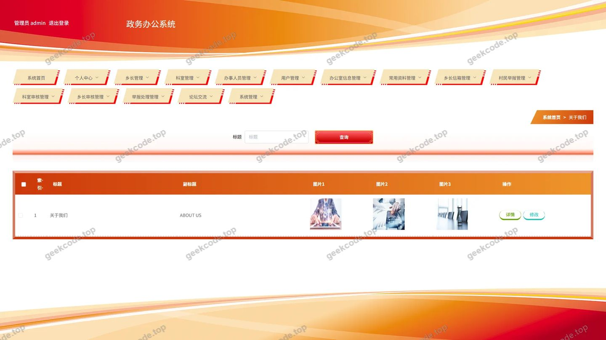</a>

<h4>前台-办公室信息列表</h4>

<a href="https://geekcode.top/archives/%E5%9F%BA%E4%BA%8Espringboot%E7%9A%84%E4%B9%A1%E6%9D%91%E6%94%BF%E5%8A%A1%E5%8A%9E%E5%85%AC%E7%B3%BB%E7%BB%9F%E7%9A%84%E8%AE%BE%E8%AE%A1%E4%B8%8E%E5%AE%9E%E7%8E%B0?utm_source=github" title="查看完整源码">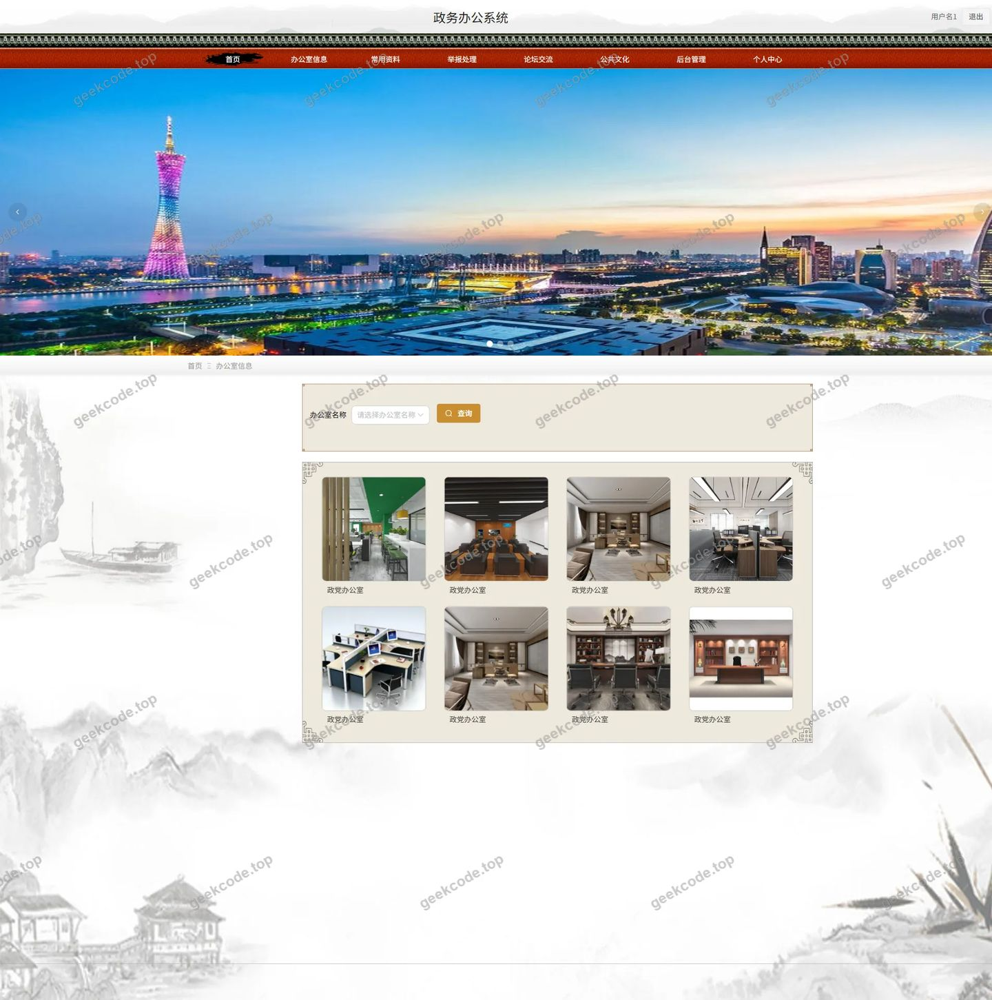</a>

<h4>前台-办事人员列表</h4>

<h4>前台-常用资料列表</h4>

<a href="https://geekcode.top/archives/%E5%9F%BA%E4%BA%8Espringboot%E7%9A%84%E4%B9%A1%E6%9D%91%E6%94%BF%E5%8A%A1%E5%8A%9E%E5%85%AC%E7%B3%BB%E7%BB%9F%E7%9A%84%E8%AE%BE%E8%AE%A1%E4%B8%8E%E5%AE%9E%E7%8E%B0?utm_source=github" title="查看完整源码">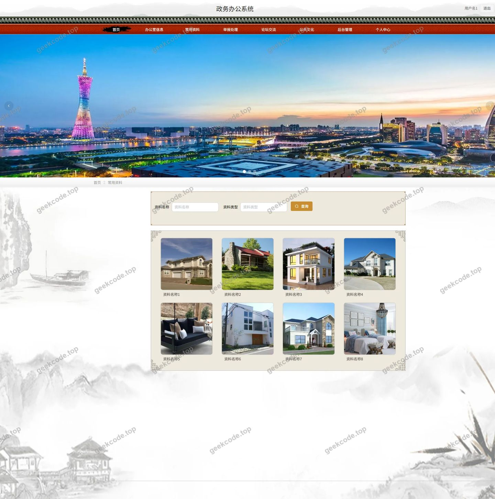</a>

<h4>前台-村民举报列表</h4>

<a href="https://geekcode.top/archives/%E5%9F%BA%E4%BA%8Espringboot%E7%9A%84%E4%B9%A1%E6%9D%91%E6%94%BF%E5%8A%A1%E5%8A%9E%E5%85%AC%E7%B3%BB%E7%BB%9F%E7%9A%84%E8%AE%BE%E8%AE%A1%E4%B8%8E%E5%AE%9E%E7%8E%B0?utm_source=github" title="查看完整源码">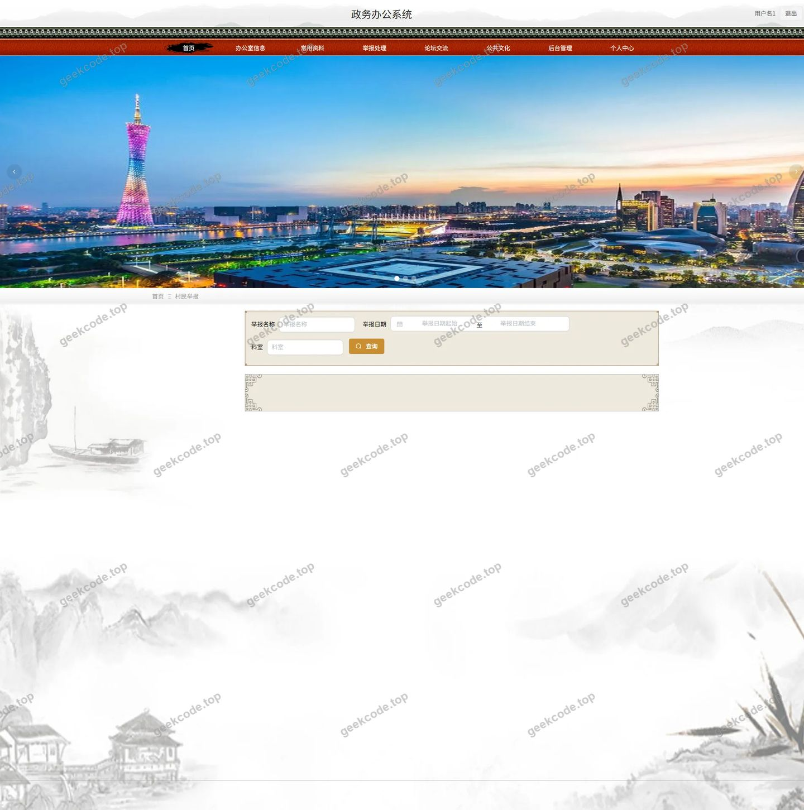</a>

<h4>前台-举报处理列表</h4>

<a href="https://geekcode.top/archives/%E5%9F%BA%E4%BA%8Espringboot%E7%9A%84%E4%B9%A1%E6%9D%91%E6%94%BF%E5%8A%A1%E5%8A%9E%E5%85%AC%E7%B3%BB%E7%BB%9F%E7%9A%84%E8%AE%BE%E8%AE%A1%E4%B8%8E%E5%AE%9E%E7%8E%B0?utm_source=github" title="查看完整源码">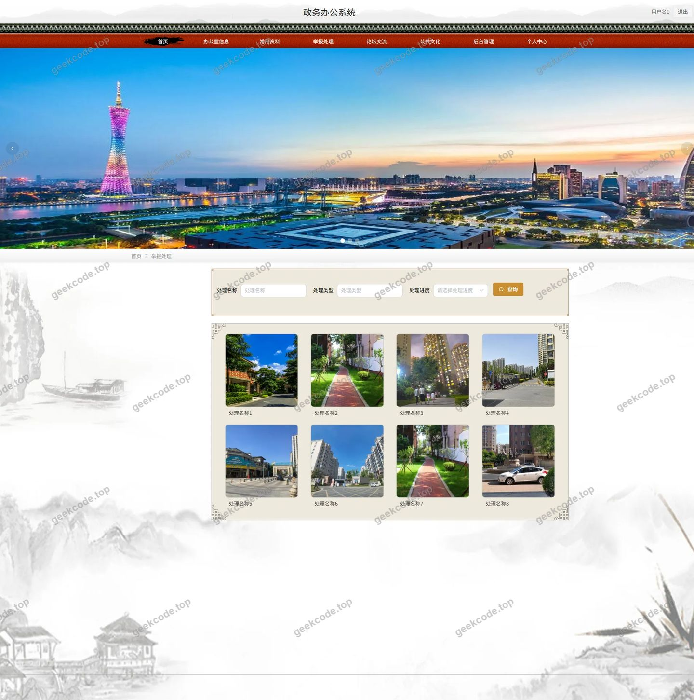</a>

<h4>前台-科室列表</h4>

<a href="https://geekcode.top/archives/%E5%9F%BA%E4%BA%8Espringboot%E7%9A%84%E4%B9%A1%E6%9D%91%E6%94%BF%E5%8A%A1%E5%8A%9E%E5%85%AC%E7%B3%BB%E7%BB%9F%E7%9A%84%E8%AE%BE%E8%AE%A1%E4%B8%8E%E5%AE%9E%E7%8E%B0?utm_source=github" title="查看完整源码">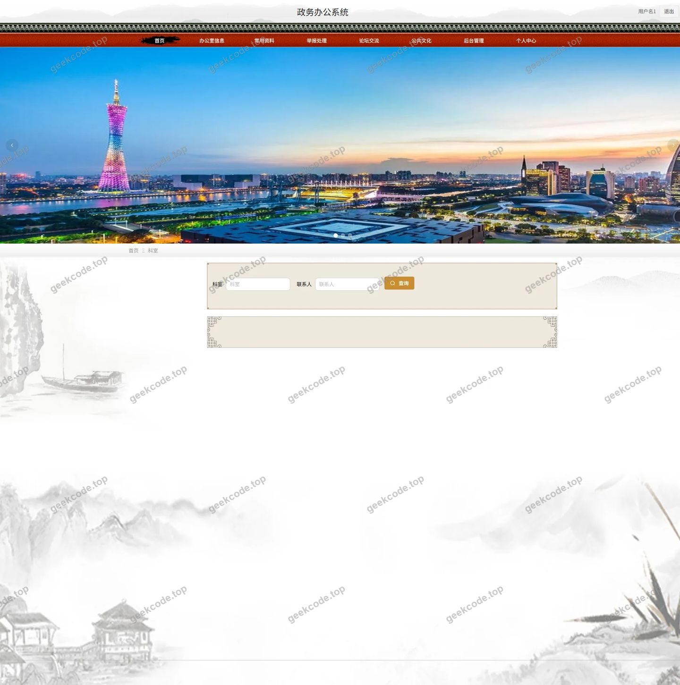</a>

<h4>前台-科室审核列表</h4>

<h4>前台-收藏列表</h4>

<a href="https://geekcode.top/archives/%E5%9F%BA%E4%BA%8Espringboot%E7%9A%84%E4%B9%A1%E6%9D%91%E6%94%BF%E5%8A%A1%E5%8A%9E%E5%85%AC%E7%B3%BB%E7%BB%9F%E7%9A%84%E8%AE%BE%E8%AE%A1%E4%B8%8E%E5%AE%9E%E7%8E%B0?utm_source=github" title="查看完整源码">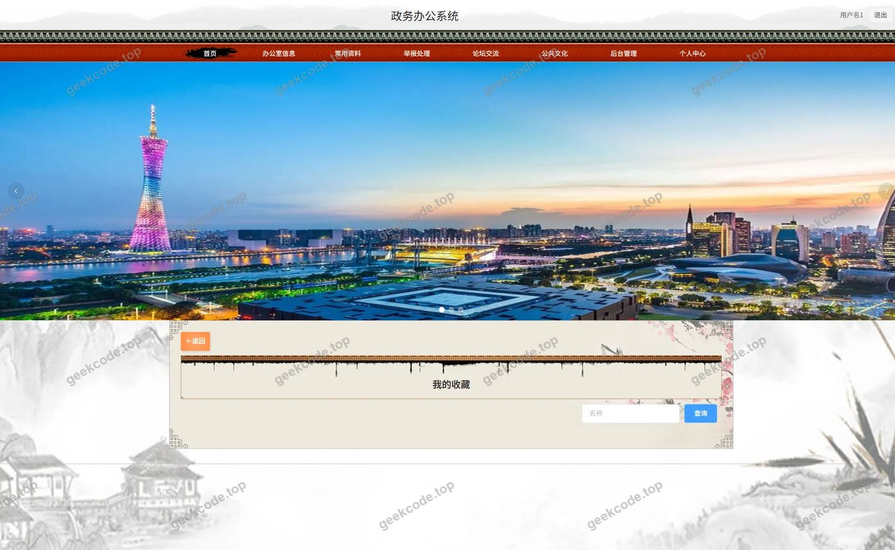</a>

<h4>前台-乡长列表</h4>

<h4>前台-乡长审核列表</h4>

<a href="https://geekcode.top/archives/%E5%9F%BA%E4%BA%8Espringboot%E7%9A%84%E4%B9%A1%E6%9D%91%E6%94%BF%E5%8A%A1%E5%8A%9E%E5%85%AC%E7%B3%BB%E7%BB%9F%E7%9A%84%E8%AE%BE%E8%AE%A1%E4%B8%8E%E5%AE%9E%E7%8E%B0?utm_source=github" title="查看完整源码">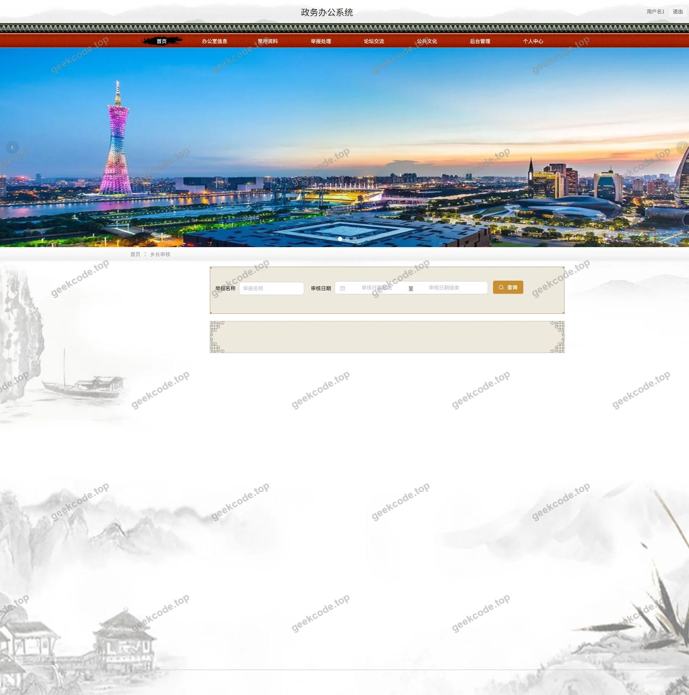</a>

<h4>前台-乡长信箱列表</h4>

<h4>前台-个人中心</h4>

<a href="https://geekcode.top/archives/%E5%9F%BA%E4%BA%8Espringboot%E7%9A%84%E4%B9%A1%E6%9D%91%E6%94%BF%E5%8A%A1%E5%8A%9E%E5%85%AC%E7%B3%BB%E7%BB%9F%E7%9A%84%E8%AE%BE%E8%AE%A1%E4%B8%8E%E5%AE%9E%E7%8E%B0?utm_source=github" title="查看完整源码">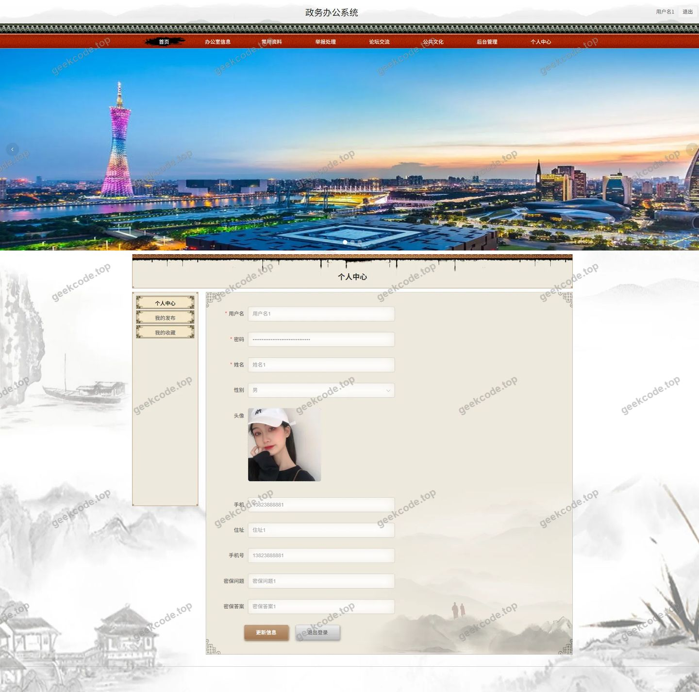</a>

<h4>前台-公告列表</h4>

<a href="https://geekcode.top/archives/%E5%9F%BA%E4%BA%8Espringboot%E7%9A%84%E4%B9%A1%E6%9D%91%E6%94%BF%E5%8A%A1%E5%8A%9E%E5%85%AC%E7%B3%BB%E7%BB%9F%E7%9A%84%E8%AE%BE%E8%AE%A1%E4%B8%8E%E5%AE%9E%E7%8E%B0?utm_source=github" title="查看完整源码">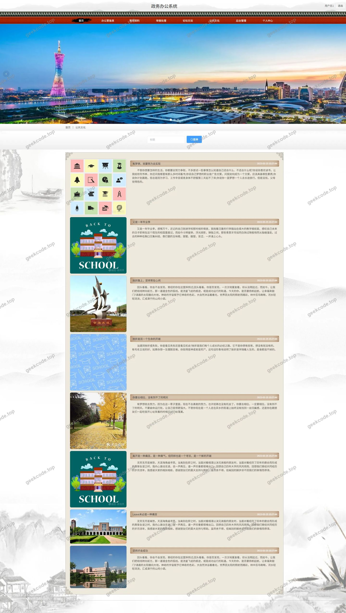</a>

<h3>后台管理端</h3>
<h4>后台-登录页</h4>

<a href="https://geekcode.top/archives/%E5%9F%BA%E4%BA%8Espringboot%E7%9A%84%E4%B9%A1%E6%9D%91%E6%94%BF%E5%8A%A1%E5%8A%9E%E5%85%AC%E7%B3%BB%E7%BB%9F%E7%9A%84%E8%AE%BE%E8%AE%A1%E4%B8%8E%E5%AE%9E%E7%8E%B0?utm_source=github" title="查看完整源码">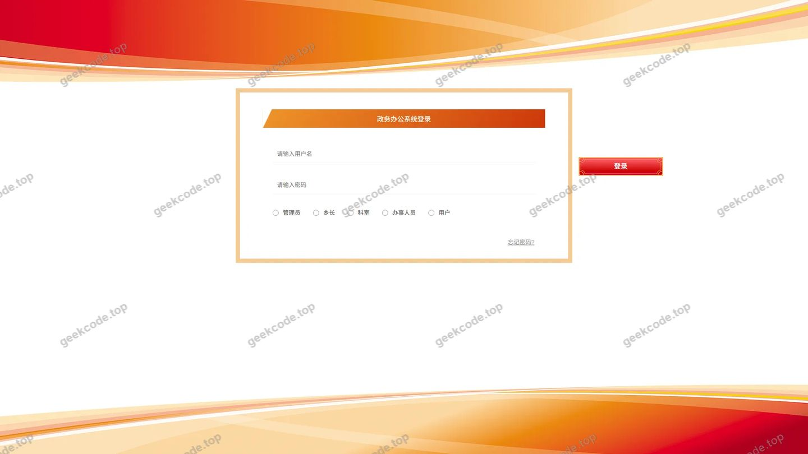</a>

<h4>后台-公共文化</h4>

<a href="https://geekcode.top/archives/%E5%9F%BA%E4%BA%8Espringboot%E7%9A%84%E4%B9%A1%E6%9D%91%E6%94%BF%E5%8A%A1%E5%8A%9E%E5%85%AC%E7%B3%BB%E7%BB%9F%E7%9A%84%E8%AE%BE%E8%AE%A1%E4%B8%8E%E5%AE%9E%E7%8E%B0?utm_source=github" title="查看完整源码">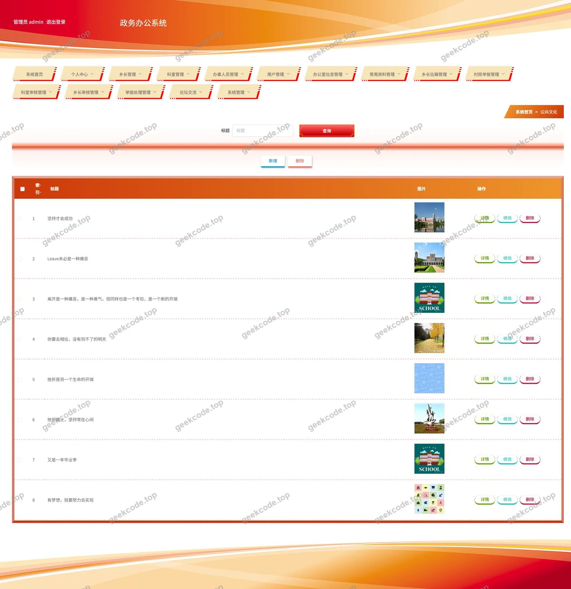</a>

<h4>后台-关于我们</h4>

<h4>后台-举报处理</h4>

<a href="https://geekcode.top/archives/%E5%9F%BA%E4%BA%8Espringboot%E7%9A%84%E4%B9%A1%E6%9D%91%E6%94%BF%E5%8A%A1%E5%8A%9E%E5%85%AC%E7%B3%BB%E7%BB%9F%E7%9A%84%E8%AE%BE%E8%AE%A1%E4%B8%8E%E5%AE%9E%E7%8E%B0?utm_source=github" title="查看完整源码">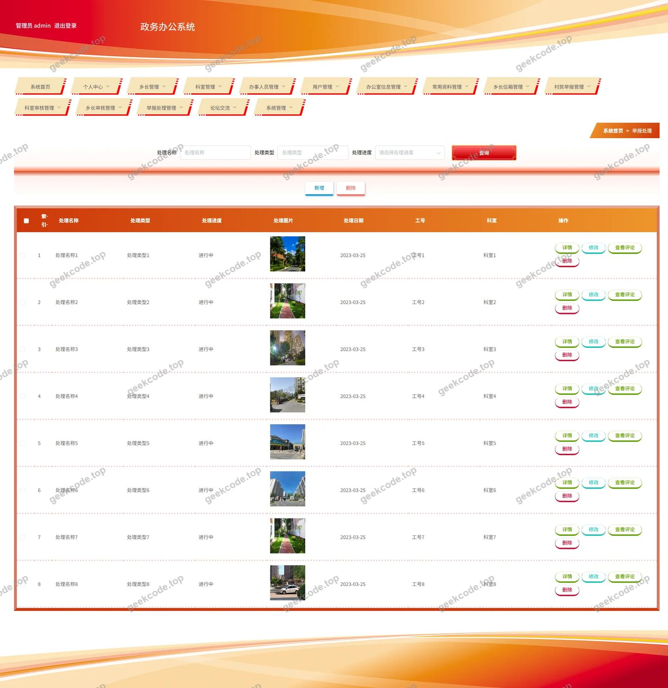</a>

<h4>后台-科室审核</h4>

<h4>后台首页</h4>

<a href="https://geekcode.top/archives/%E5%9F%BA%E4%BA%8Espringboot%E7%9A%84%E4%B9%A1%E6%9D%91%E6%94%BF%E5%8A%A1%E5%8A%9E%E5%85%AC%E7%B3%BB%E7%BB%9F%E7%9A%84%E8%AE%BE%E8%AE%A1%E4%B8%8E%E5%AE%9E%E7%8E%B0?utm_source=github" title="查看完整源码">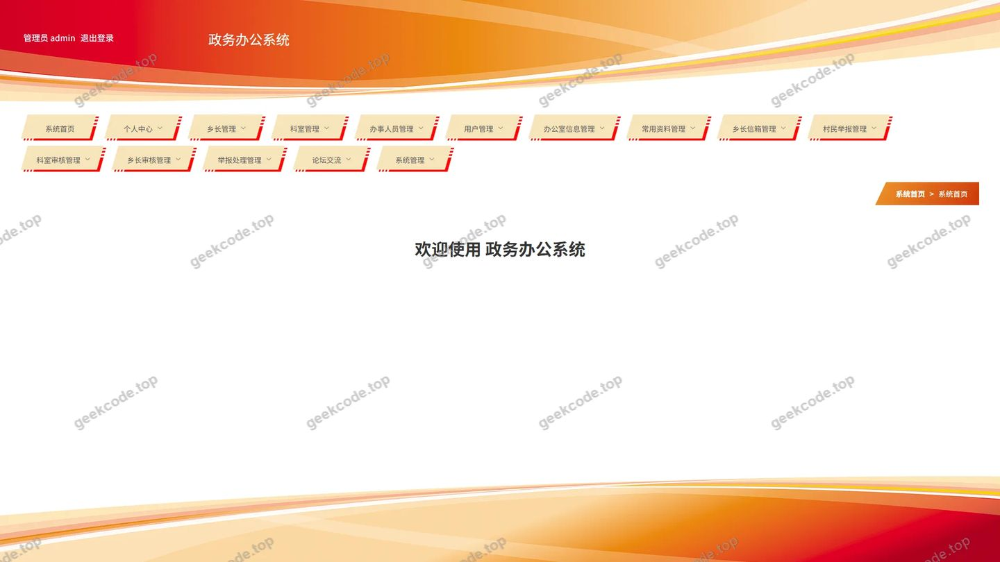</a>

<h4>后台-乡长审核</h4>

<a href="https://geekcode.top/archives/%E5%9F%BA%E4%BA%8Espringboot%E7%9A%84%E4%B9%A1%E6%9D%91%E6%94%BF%E5%8A%A1%E5%8A%9E%E5%85%AC%E7%B3%BB%E7%BB%9F%E7%9A%84%E8%AE%BE%E8%AE%A1%E4%B8%8E%E5%AE%9E%E7%8E%B0?utm_source=github" title="查看完整源码">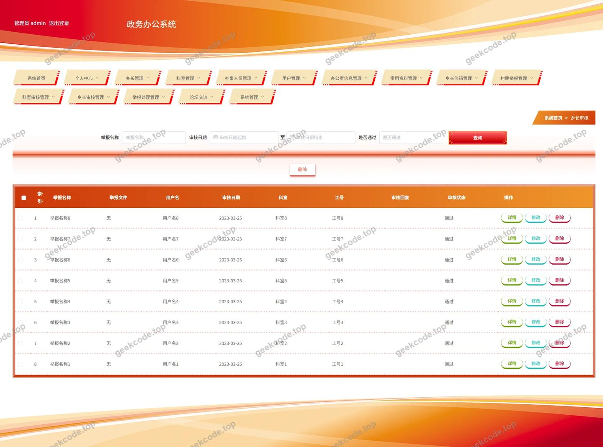</a>

<h4>后台-乡长信箱</h4>

<a href="https://geekcode.top/archives/%E5%9F%BA%E4%BA%8Espringboot%E7%9A%84%E4%B9%A1%E6%9D%91%E6%94%BF%E5%8A%A1%E5%8A%9E%E5%85%AC%E7%B3%BB%E7%BB%9F%E7%9A%84%E8%AE%BE%E8%AE%A1%E4%B8%8E%E5%AE%9E%E7%8E%B0?utm_source=github" title="查看完整源码">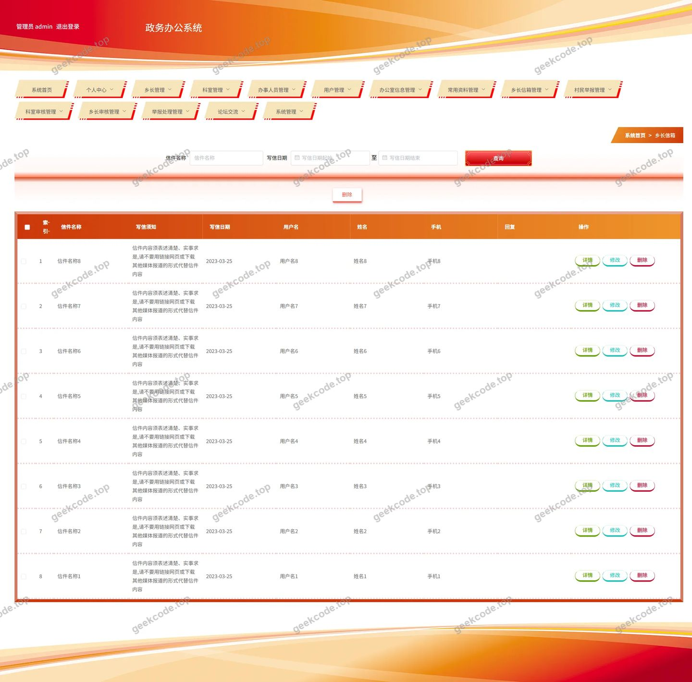</a>

---

## 获取完整源码

| 项目 | 说明 |
| --- | --- |
| 项目名 | 基于springboot的乡村政务办公系统的设计与实现 |
| 运行截图 | 本文 22 张（站点带水印原图，仓库 `images/` 目录） |
| 完整源码 | [https://geekcode.top/archives/%E5%9F%BA%E4%BA%8Espringboot%E7%9A%84%E4%B9%A1%E6%9D%91%E6%94%BF%E5%8A%A1%E5%8A%9E%E5%85%AC%E7%B3%BB%E7%BB%9F%E7%9A%84%E8%AE%BE%E8%AE%A1%E4%B8%8E%E5%AE%9E%E7%8E%B0?utm_source=github](https://geekcode.top/archives/%E5%9F%BA%E4%BA%8Espringboot%E7%9A%84%E4%B9%A1%E6%9D%91%E6%94%BF%E5%8A%A1%E5%8A%9E%E5%85%AC%E7%B3%BB%E7%BB%9F%E7%9A%84%E8%AE%BE%E8%AE%A1%E4%B8%8E%E5%AE%9E%E7%8E%B0?utm_source=github) |
| 咨询微信 | **ir9372**（备注：jingpin-yuanma） |
| 更多项目 | [极客代码 geekcode.top](https://geekcode.top/?utm_source=github) |

> 需要源码、部署、改配置、跑不起来等问题，加微信 ir9372 沟通，说明项目名即可。
